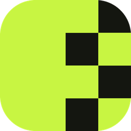

<p align="center"></p>

# ProductStudio

A desktop app for Windows that turns plain product photos into clean, ready-to-post pictures.
It removes the background, puts the product on a backdrop, adds a shadow and your watermark,
and exports one photo or a whole folder. Everything runs on your own PC. No photo is uploaded anywhere.

## What it does

- **Cut out** – removes the background automatically. A brush lets you erase or restore details.
- **Scene** – solid, linear and radial backdrops, your own backdrop pictures, four shadow styles,
  square / portrait / landscape / original / custom sizes. Drag the product to move it, drag a corner to resize it.
- **Brand** – a brand kit (name, tagline, handle, logo) and 26 watermark styles: wordmarks, signatures,
  monograms, stamps, badges and ribbons. Place one mark, or tile it across the photo.
- **Batch** – open many files or a whole folder, style one photo and apply the look to the rest,
  with progress, pause, resume and stop.
- **Export** – PNG or JPEG, transparent cutouts, naming rules, and a choice of what to do when a file exists.
- Undo and redo (Ctrl+Z / Ctrl+Y) everywhere.

## Run it

You need **Windows 10 or 11 (64-bit)** and **Python 3.10 or newer** from
[python.org](https://www.python.org/downloads/). In the Python installer, tick *Add python.exe to PATH*.

1. Download this project: **Code → Download ZIP** and unzip it, or

   ```
   git clone https://github.com/matthewparmely7-coder/productstudio.git
   ```

2. Double-click **`run.cmd`**.

The first start takes a few minutes: it installs the libraries into a `.venv` folder inside the project
and downloads the background-removal model (178 MB). After that the app starts right away,
and no internet connection is needed.

### By hand

```
python -m venv .venv
.venv\Scripts\activate
pip install -r requirements.txt
python download_model.py
python app.py
```

If the model download is blocked on your network, download
[isnet-general-use.onnx](https://github.com/danielgatis/rembg/releases/download/v0.0.0/isnet-general-use.onnx)
in a browser and save it as `models\isnet-general-use.onnx`.

## Build a standalone .exe

Run `run.cmd` once, then double-click **`build.cmd`**. The finished app is in `dist\ProductStudio`.
Copy that whole folder to any Windows PC; Python is not needed there.

## Where your things are kept

Saved backdrops, sizes, brand kit and watermarks are stored in
`%APPDATA%\Product Studio\Product Studio`. Delete that folder to start fresh.
Your photos are never changed; exports are written as new files.

## Project layout

| File | What is in it |
| --- | --- |
| `app.py` | Main window: start screen, editor, panels, photo strip, jobs, undo |
| `engine.py` | Cutout, backdrops, shadows and watermarks. No window code |
| `canvas.py` | The stage where the product is moved and resized |
| `refine.py` | The edge brush |
| `maker.py` | Brand kit and watermark editor |
| `colorpick.py` | Color and gradient dialogs, screen color picker |
| `export_dialog.py` | Export options |
| `jobs.py` | Batch jobs, folder scanning, file naming |
| `ui_kit.py` | Colors, style sheet, icons and small widgets |
| `download_model.py` | Fetches the model file |

## Credits

- Background removal uses the IS-Net model from
  [Dichotomous Image Segmentation](https://github.com/xuebinqin/DIS) (Apache License 2.0),
  in the ONNX build published by [rembg](https://github.com/danielgatis/rembg).
- Fonts in `assets/fonts` are under the SIL Open Font License; the licence files are next to them.
- Built with [PySide6](https://doc.qt.io/qtforpython-6/), [Pillow](https://python-pillow.org/),
  [NumPy](https://numpy.org/) and [ONNX Runtime](https://onnxruntime.ai/).
