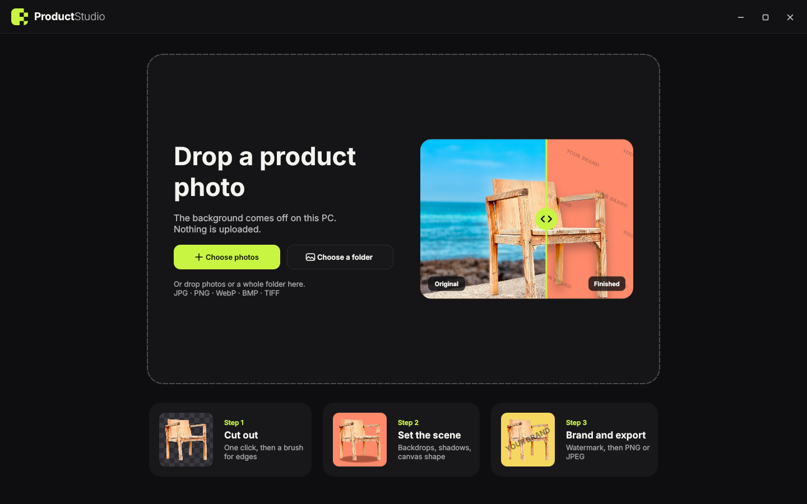

<p align="center"></p>

# ProductStudio

A desktop app for Windows that turns plain product photos into clean, ready-to-post pictures.
It removes the background, puts the product on a backdrop, adds a shadow and your watermark,
and exports one photo or a whole folder.

Everything runs on your own PC. No photo is uploaded anywhere, and no account is needed.



## Contents

- [Features](#features)
- [Install and run](#install-and-run)
- [Your first photo in two minutes](#your-first-photo-in-two-minutes)
- [The window](#the-window)
- [Opening photos](#opening-photos)
- [Step 1: Cut out](#step-1-cut-out)
- [Step 2: Scene](#step-2-scene)
- [Step 3: Brand](#step-3-brand)
- [Working with many photos](#working-with-many-photos)
- [Export](#export)
- [Keyboard and mouse](#keyboard-and-mouse)
- [Where your things are kept](#where-your-things-are-kept)
- [Problems and fixes](#problems-and-fixes)
- [Build a standalone .exe](#build-a-standalone-exe)
- [Project layout](#project-layout)
- [Credits](#credits)
- [License](#license)

## Features

**Background removal**
- One click, done on your PC by the IS-Net model. No internet needed after setup.
- An edge brush to erase leftovers or bring back parts that were cut by mistake.
- Save the bare cutout as a transparent PNG.

**Scene**
- 11 starter backdrops: 5 solid colors, 3 linear gradients, 3 radial gradients.
- Make your own color or gradient, with a picker that can take a color from anywhere on the screen.
- Use your own pictures as backdrops. They are kept in the list until you remove them.
- Four shadows (None, Soft, Floor, Hard) with strength and direction.
- Sizes: Square, Portrait, Landscape, Original, or any size you type in and save.
- Move, resize and flip the product right on the picture.

**Brand**
- A brand kit you fill in once: name, tagline, handle and logo.
- 26 watermark styles in six groups: Text, Script, Monogram, Badge, Label and Logo.
- Six placements: one mark, centered, diagonal, grid, brick, or a band along the bottom.
- Five looks: Solid, Outline, Shadow, Emboss, Label.
- Customize any style (text, font, letter spacing, case, symbol) and save it under *Mine*.

**Batch work**
- Open many files or a whole folder, with or without subfolders.
- Each photo keeps its own look. Copy one look to the selected photos or to all of them.
- A progress bar for long jobs, with Pause, Resume and Stop.

**Export**
- PNG or JPEG, one photo or all of them.
- Save next to each original or into one folder, with naming rules.
- Your original photos are never overwritten.

**Comfort**
- Undo and redo for every change.
- Hold **Compare** to see the original photo.

## Install and run

You need:

- **Windows 10 or 11**, 64-bit
- **Python 3.10 or newer** from [python.org](https://www.python.org/downloads/).
  In the Python installer, tick **Add python.exe to PATH**.
- About 1 GB of free disk space and an internet connection for the first start only.

### The easy way

1. Download the project. On the GitHub page press **Code → Download ZIP**, then unzip it.
   Or, with Git:

   ```
   git clone https://github.com/matthewparmely7-coder/productstudio.git
   ```

2. Open the folder and double-click **`run.cmd`**.

The first start takes a few minutes. It creates a `.venv` folder inside the project, installs the
libraries into it, and downloads the background-removal model (178 MB). Nothing is installed
anywhere else on your PC. Every later start is quick: just double-click `run.cmd` again.

### By hand

Open a terminal in the project folder and run:

```
python -m venv .venv
.venv\Scripts\activate
pip install -r requirements.txt
python download_model.py
python app.py
```

If the model download is blocked on your network, download
[isnet-general-use.onnx](https://github.com/danielgatis/rembg/releases/download/v0.0.0/isnet-general-use.onnx)
in a browser and save it as `models\isnet-general-use.onnx`.

## Your first photo in two minutes

1. Start the app and press **Choose photos**. Pick one product photo.
2. Wait a few seconds. The background disappears and the product sits on a clean backdrop.
3. Press **Scene** at the top. Click a backdrop color, then a shadow.
4. Press **Brand**. Press **Edit**, type your brand name, press **Save**, then click a watermark style.
5. Press **Export**, then **Choose where to save…**, and pick a name. Done.

The rest of this guide explains each part in detail.

## The window

| Area | What it is for |
| --- | --- |
| **Top bar, left** | The logo. Click it to go back to the start screen. *Back to editor* returns you. |
| **Top bar, middle** | The three steps: **Cut out**, **Scene**, **Brand**. Click one to open its panel on the right. |
| **Top bar, right** | Undo, Redo, **Compare**, **Apply to all**, **Export**, then minimize, maximize and close. |
| **Left strip** | Your photos. Each thumbnail shows the finished look, not the original. |
| **Middle** | The picture you are working on, at its export shape. |
| **Right panel** | The settings of the step you chose. |

Short messages appear at the top of the window and go away on their own.
Hover over one to read more detail when there is any.

## Opening photos

ProductStudio opens JPG, PNG, WebP, BMP and TIFF files.

- **Choose photos** opens one or many files.
- **Choose a folder** opens every photo in a folder. If the subfolders also hold photos,
  the app asks whether to include them.
- **Drag and drop** files or a folder onto the window.
- Once you are in the editor, the **+** button at the top of the left strip adds more photos.

The background of the photo you are looking at is removed first.
The others are done one by one while you work. A moving border on a thumbnail shows it is being processed.

## Step 1: Cut out

The background is removed automatically. The panel on the right gives you:

- **Edge softness** – a slider that softens the outline of the product. Raise it a little if the edge looks too sharp.
- **Refine edges** – opens the brush screen (below).
- **Remove background again** – starts over from the original photo and drops your brush work.
- **Save cutout as PNG** – saves only the product on a transparent background.

### Refine edges

Use this when the automatic cutout left a bit of background, or removed part of the product.

- **Erase** paints parts away. **Restore** brings them back. **Move** drags the picture around.
- **Brush size** sets how wide the brush is. **Hard** gives a crisp edge, **Soft** a gentle one.
- The four small squares at the top change how the picture is shown:
  removed area tinted in coral, transparent, on black, or on white.
  Try black and white to spot leftovers you cannot see otherwise.
- Zoom with the mouse wheel or the **−** and **+** buttons. **Fit** shows the whole photo.
  Hold the middle mouse button and drag to move around.
- The arrows undo and redo brush strokes. **Reset** goes back to the automatic cutout.
- **Done** keeps your changes. **Cancel** drops them.

## Step 2: Scene

### Backdrop

- Click a tile to use that color or gradient.
- The **rainbow tile** makes a new backdrop: choose *Solid*, *Linear* or *Radial*, pick the colors,
  and for a linear gradient set the direction. In the color picker, the dropper button lets you
  click any color on your screen.
- The **picture tile** adds your own image as a backdrop. With an image backdrop you can choose
  **Cover** (fill the whole picture, cropping if needed) or **Contain** (show the whole image).
- To remove a backdrop, hover over its tile and click the small **×**, or right-click it.
  Right-click any color tile and choose *Restore the starter backdrops* to bring the first set back.

### Shadow

- **None**, **Soft** (a gentle drop shadow), **Floor** (a contact shadow under the product) or **Hard** (a crisp offset shadow).
- **Strength** makes it lighter or darker. **Direction** turns it around the product.

### Shape

- **Square** 1600 × 1600, **Portrait** 1200 × 1600, **Landscape** 1600 × 1200.
- **Original** keeps each photo at its own size.
- Or type a width and height (64 to 6000 pixels). **Save size** adds it to the list.
  Saved sizes can be removed with their **×**; the built-in ones stay.

### Moving the product

- **Drag** the product to move it. **Drag a corner** to make it bigger or smaller.
- The small bar above the product has three buttons: **Center on canvas**, **Flip horizontally** and **Refine edges**.

## Step 3: Brand

### Your brand kit

Press **Edit** at the top of the panel and fill in your **name**, **tagline**, **handle** (for example `@yourshop`)
and, if you have one, a **logo** image. A PNG with a transparent background works best.
Every watermark style is drawn from this kit, so you only type it once.

### Pick a watermark

The styles are grouped. Click a group, then a style:

| Group | Styles |
| --- | --- |
| **Text** | Wordmark, Airy, Classic, Stacked, Ruled, Copyright, Handle, Brackets |
| **Script** | Signature, Autograph |
| **Monogram** | Circle, Square, Diamond, Split |
| **Badge** | Badge, Crest, Seal, Hexagon, Shield |
| **Label** | Pill, Framed, Tag, Ribbon |
| **Logo** | Logo + name, Logo over name, Logo only |
| **Mine** | Watermarks you saved, plus **Upload** and **Create** |

**None** removes the watermark from the photo.

### Goal: three quick setups

- **Brand** – a quiet mark in the corner.
- **Protect** – a faint repeat over the whole photo that is hard to remove.
- **Proof** – a large mark across the center, for previews you send to clients.

Press one and adjust from there.

### Placement

- **Single** – one mark. A pad with nine dots chooses the spot (corners, edges, center),
  and **Edge margin** sets how far it sits from the border.
- **Center** – one mark in the middle.
- **Diagonal** – one large mark across the picture.
- **Grid** and **Brick** – the mark repeated over the whole picture.
- **Band** – a strip along the bottom.

### Look, color and sliders

- **Look**: Solid, Outline, Shadow, Emboss or Label (the mark on a small plate).
- **Color**: Automatic (white on dark photos, dark on light ones), White, Black, or any color.
- **Size**, **Strength** (how visible it is), **Angle** and **Spacing** (the gap between repeats).

### Make it your own

- **Customize** opens the editor for the current style: change the text, the font
  (Modern, Condensed, Classic, Script, Handwritten, Mono), letter spacing, upper or lower case, and the symbol.
  **Save to My watermarks** puts it under **Mine**.
- **Upload** (in *Mine*) uses your own logo or pattern image as the watermark.
- **Create** (in *Mine*) starts a new one from any style.

## Working with many photos

**Selecting** in the left strip:

- **Click** a photo to work on it.
- **Ctrl+click**, or click the round mark on a thumbnail, to add it to the selection or take it out.
- **Shift+click** to select a range.
- **Ctrl+A**, or the check button at the bottom of the strip, selects all.

**Each photo has its own look.** Changing the backdrop of one photo does not change the others.

**Apply to all** copies the look of the current photo (backdrop, shadow, shape, watermark, size and position
of the product) to the selected photos, or to all of them when only one is selected.
A bar at the bottom shows the progress, and each thumbnail shows its own. You can **Pause**, **Resume** or **Stop**.

**Removing photos:** select them and press the trash button or the **Delete** key.
**Clear** empties the whole list. The app asks before it removes anything.
This only takes photos out of the list. Files on your disk are never deleted.

Only one big job runs at a time. If you start another while one is running, the app tells you to wait.

## Export

Press **Export** or **Ctrl+E**.

1. **What**: *This photo*, or all (or the selected) photos.
2. **Format**: **PNG** for the best quality, or **JPEG** for smaller files. For JPEG a slider sets the quality.
3. **Also save a transparent cutout of each photo** – tick this to get the bare product as an extra PNG.

For a single photo, press **Choose where to save…** and pick the place and name.

For many photos you also choose:

- **Save to**: *Next to each original*, or *One folder* that you pick.
- **File names**: a ready-made rule such as *Original name + "-studio"* or *Numbered: product-001*,
  or your own. In your own rule `{name}` stands for the original file name and `{n}` for a running number.
  Example: `shop-{name}-{n}` gives `shop-chair-001.png`.
- **If a file already exists**: *Add a number*, *Replace* or *Skip*.

Your original photos are never overwritten.

## Keyboard and mouse

| Key or action | What it does |
| --- | --- |
| **Ctrl+O** | Open photos |
| **Ctrl+E** | Export |
| **Ctrl+Z** | Undo one step |
| **Ctrl+Y** or **Ctrl+Shift+Z** | Redo |
| **Ctrl+A** | Select all photos |
| **Delete** | Remove the selected photos from the list |
| **Ctrl+click** / **Shift+click** on a thumbnail | Add to the selection / select a range |
| Drag the product | Move it |
| Drag a corner | Resize it |
| Hold **Compare** | Show the original photo |
| Mouse wheel (Refine edges) | Zoom |
| Middle button drag (Refine edges) | Move around the picture |

## Where your things are kept

Your backdrops, saved sizes, brand kit and watermarks are stored in
`%APPDATA%\Product Studio\Product Studio`. Paste that into the address bar of File Explorer to open it.
Delete the folder to start fresh.

The photos you open are only read. Nothing is written until you export.

## Problems and fixes

**"Python 3.10 or newer is required."**
Install Python from python.org and tick *Add python.exe to PATH*. Then run `run.cmd` again.

**The setup stops while installing libraries.**
Check your internet connection, delete the `.venv` folder in the project, and run `run.cmd` again.

**"The model file is missing."**
Run `python download_model.py`, or download the file in a browser as described under *By hand*.

**The first cutout takes long.**
The model is loaded on first use. Later photos are faster. Large batches take time because all work is done on your processor.

**The cutout is not clean.**
Use **Refine edges**. Photos with a clear, sharp product on a plain background give the best results.

**I want to move the app to another PC.**
Build the standalone version (next section) and copy that folder.

## Build a standalone .exe

Run `run.cmd` once, then double-click **`build.cmd`**. The finished app is in `dist\ProductStudio`.
Copy that whole folder to any Windows PC and start `ProductStudio.exe`. Python is not needed there.

## Project layout

| File | What is in it |
| --- | --- |
| `app.py` | Main window: start screen, editor, panels, photo strip, jobs, undo |
| `engine.py` | Cutout, backdrops, shadows and watermarks. No window code |
| `canvas.py` | The stage where the product is moved and resized |
| `refine.py` | The edge brush |
| `maker.py` | Brand kit and watermark editor |
| `colorpick.py` | Color and gradient dialogs, screen color picker |
| `export_dialog.py` | Export options |
| `jobs.py` | Batch jobs, folder scanning, file naming |
| `ui_kit.py` | Colors, style sheet, icons and small widgets |
| `download_model.py` | Fetches the model file |
| `run.cmd`, `build.cmd` | Start the app, build the .exe |
| `assets/` | Logo, icon, start-screen pictures and fonts |

## Credits

- Background removal uses the IS-Net model from
  [Dichotomous Image Segmentation](https://github.com/xuebinqin/DIS) (Apache License 2.0),
  in the ONNX build published by [rembg](https://github.com/danielgatis/rembg).
- Fonts in `assets/fonts` are under the SIL Open Font License; the licence files are next to them.
- Built with [PySide6](https://doc.qt.io/qtforpython-6/), [Pillow](https://python-pillow.org/),
  [NumPy](https://numpy.org/) and [ONNX Runtime](https://onnxruntime.ai/).

## License

[MIT](LICENSE). You are free to use, change and share it.
